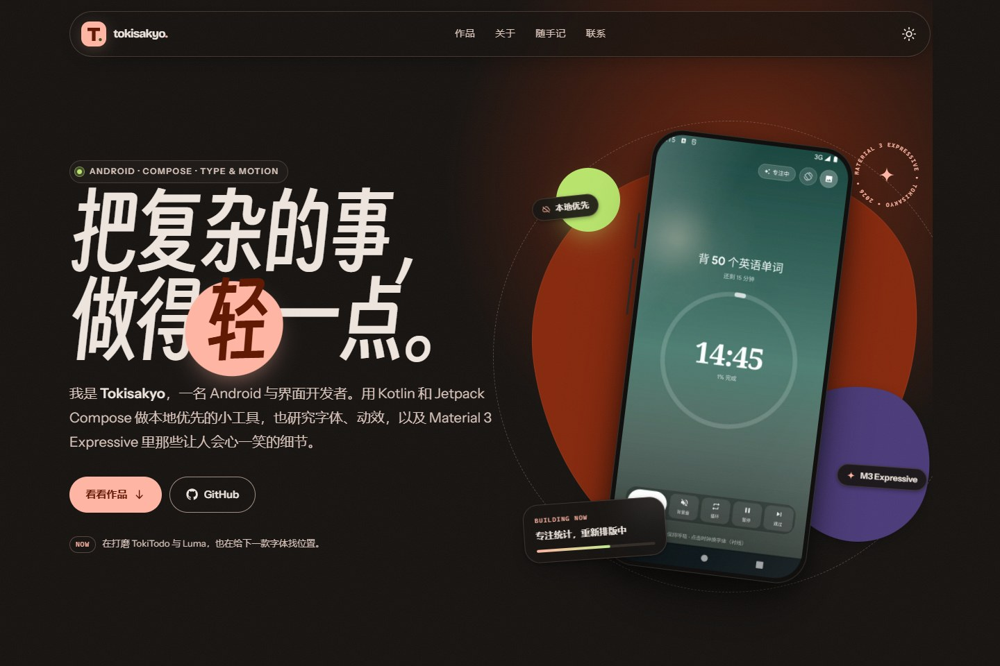

# Tokisakyo — personal site

一个 **Material 3 Expressive** 风格的个人网站，为 [ichiyotsu.github.io](https://ichiyotsu.github.io/) 而做。

**Live:** <https://ichiyotsu.github.io/>

纯静态 HTML / CSS / JS，零构建步骤，直接推到 GitHub Pages 就能用。

| Desktop | Mobile |
| --- | --- |
|  |  |

深色模式：



---

## 里面有什么

- **M3 Expressive 的视觉语言**：动态色角色、超大字号、不对称圆角、药丸按钮、状态层、弹簧动效。
- **两套主题**：浅色 / 深色，跟随系统，也可手动切换；支持圆形揭开过渡与 `prefers-reduced-motion`。
- **完整个人站结构**：Hero、精选作品、关于 / 现在、随手记、联系。
- **移动端底部导航**：`<dialog>` 实现的 bottom sheet，带焦点管理与滚动锁定。
- **真实项目截图**：TokiTodo、Luma（Discover）、TokiNote、TokiFonts，全部本地托管并压缩为 WebP。
- **性能与隐私**：无框架、无追踪、无 Cookie；字体全部本地托管，页面不请求第三方资源。
- **可访问性**：跳转链接、语义标题层级、键盘焦点、`aria-current`、reduced-motion 支持。
- **GitHub Pages 就绪**：`.nojekyll`、`robots.txt`、`sitemap.xml`、`site.webmanifest`、`404.html`、OG 卡片。

## 本地预览

任选一种：

```powershell
# 推荐：本地静态服务器
python -m http.server 4173
# 然后打开 http://127.0.0.1:4173/

# 或者直接双击 index.html
```

> 建议用本地服务器，避免个别浏览器对 `file://` 字体加载的限制。

## 部署到 GitHub Pages

```powershell
git init
git add .
git commit -m "feat: personal site"
git branch -M main
git remote add origin https://github.com/ichiyotsu/ichiyotsu.github.io.git
git push -u origin main
```

然后到仓库 **Settings → Pages**，选择 **Deploy from a branch**，分支 `main`、目录 `/ (root)`。

几分钟后访问 <https://ichiyotsu.github.io/>。后续每次 push 会自动更新。

## 改内容

| 想改什么 | 去哪里 |
| --- | --- |
| 标题、描述、OG / canonical | `index.html` 的 `<head>` |
| 首屏文案、按钮 | `index.html` 的 `.hero` |
| 项目卡片、链接、标签 | `index.html` 的 `.work-grid` |
| 关于、最近在做 | `index.html` 的 `.about-panel` |
| 随手记 | `index.html` 的 `.notes-grid`（原生 `<details>`，可展开） |
| 联系方式 | `index.html` 的 `.contact` 与页脚 |
| 颜色、圆角、动效、字体 | `assets/css/tokens.css` |
| 布局与组件 | `assets/css/*.css` |
| 交互 | `assets/js/main.js` |
| 头像 | 替换 `assets/img/avatar.webp` |
| 项目截图 | 替换 `assets/img/*.webp`，同时更新 `width` / `height` |
| 分享卡片 | 替换 `assets/img/og.jpg`（1200×630） |

### 如果换了域名

全局搜索并替换：

- `https://ichiyotsu.github.io/`（canonical、OG、JSON-LD、sitemap、robots）
- 同时把 `CNAME` 文件放到根目录（使用自定义域名时）。

### 如果改中文标题 / 文案

展示用中文字体是 **得意黑（Smiley Sans）的字符子集**，当前只包含站内已用到的字，约 60 KB。新加的字如果不在子集里，会优雅回退到系统字体，但字形会不统一。

补充字库的步骤见 [`assets/fonts/README.md`](assets/fonts/README.md)。想省事也可以直接换成完整版 WOFF2（约 1.1 MB）。

## 目录

```text
.
├─ index.html
├─ 404.html
├─ site.webmanifest
├─ robots.txt
├─ sitemap.xml
├─ .nojekyll
├─ assets/
│  ├─ css/
│  │  ├─ tokens.css        # 设计令牌、明暗色、字体
│  │  ├─ base.css          # reset、排版、背景、动效基础
│  │  ├─ components.css    # 顶栏、按钮、手机壳、bottom sheet、页脚
│  │  └─ sections.css      # Hero、作品、关于、随手记、联系
│  ├─ js/main.js
│  ├─ fonts/               # 自托管字体 + OFL 授权
│  └─ img/                 # WebP 截图、头像、图标、OG
├─ docs/                   # README 预览图
├─ tools/update-chars.mjs  # 从页面文案提取字体子集字符
├─ CONTENT.md              # 内容规划与写作建议
└─ README.md
```

`_source/`、`_tools/`、`_preview/` 只用于这次制作的本地素材与截图，已在 `.gitignore` 中忽略；正常开发与部署只需要上面的站点文件。

## 设计笔记

- **颜色**：暖纸色背景 + 柿子橙主色 + 薰衣草紫 / 青柠点缀。所有前景 / 背景组合按 M3 角色成对定义，深色模式是独立的一套，不是简单反色。
- **字体**：Bricolage Grotesque（拉丁展示）+ 得意黑（中文展示）+ Instrument Sans（正文拉丁）+ 系统中文字体。中文展示字刻意带一点斜度和不规则，和 M3 Expressive 的「有性格」对齐。
- **形状**：卡片 28–48px 大圆角；Hero 的「轻」是一个有机形色块；作品卡片允许内容溢出、被裁切，制造海报感。
- **动效**：弹簧只用在按钮、箭头、手机悬浮这些「可以玩」的地方；正文和导航保持克制。所有动效都可被系统「减少动态效果」关闭。

## 内容建议

站点结构和文案只是第一版。下一版可以加什么、每个项目怎么写、有哪些文章选题，见 **[CONTENT.md](CONTENT.md)**。

## Credits

- 字体：[Bricolage Grotesque](https://github.com/ateliertriay/bricolage)、[Instrument Sans](https://github.com/Instrument/instrument-sans)、[得意黑 Smiley Sans](https://github.com/atelier-anchor/smiley-sans)，均为 SIL OFL 1.1，授权文件在 `assets/fonts/`。
- 项目截图来自 [ichiyotsu](https://github.com/ichiyotsu) 的公开仓库：TokiTodo、Discover（Luma）、TokiNote、TokiFonts。
- 页面代码为这个项目手写，未引入 UI 框架或第三方 JS。

## License

页面代码可自由参考和修改；项目截图、头像与个人内容的版权归 Tokisakyo 所有。若要把这个模板公开为开源项目，建议补一个 MIT / CC BY 许可证。
