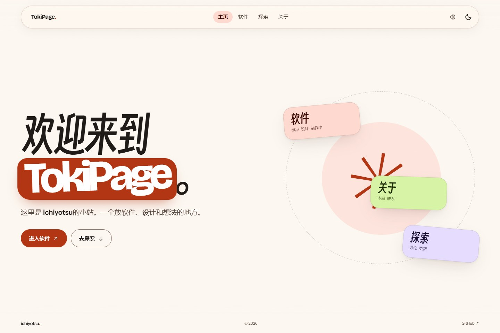
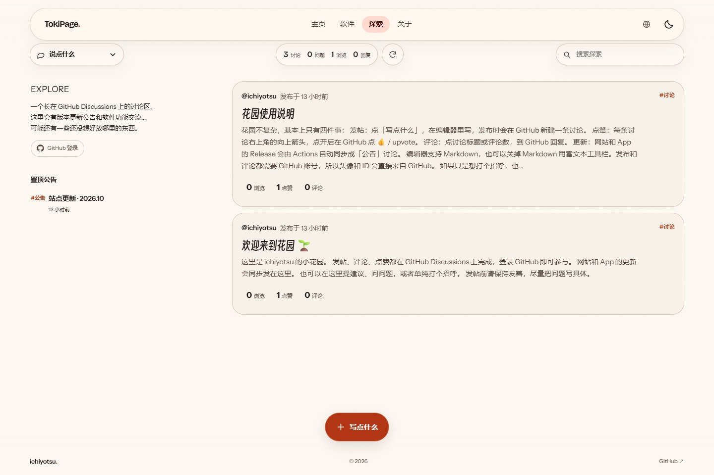
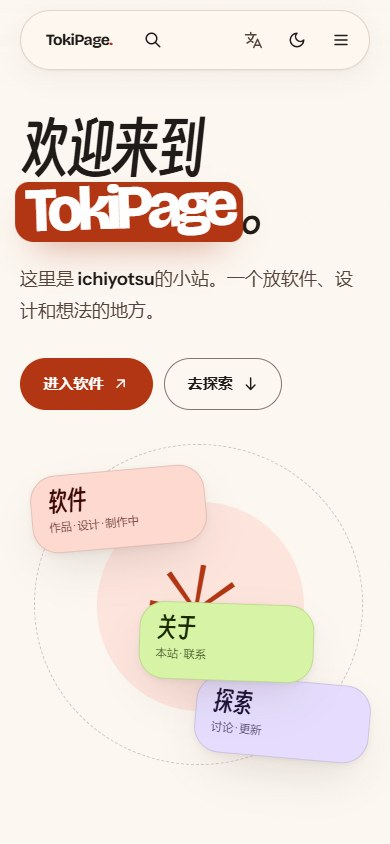

# TokiPage.

**Live:** <https://ichiyotsu.github.io/>

一个 **Material 3 Expressive** 风格的个人网站：TokiPage 主页、软件详情页、X 式探索信息流，以及一个只用本地文本编辑的 studio。

纯静态 HTML / CSS / JS，零构建步骤。

| 主页 | 软件 |
| --- | --- |
|  |  |

| 探索 | 软件详情 |
| --- | --- |
|  |  |

移动端：



---

## 页面

| 路径 | 内容 |
| --- | --- |
| `/` | **TokiPage**：欢迎语 + 三张可点击的入口卡（软件 / 探索 / 关于），底部一行短句 |
| `/software/` | **软件**：作品、TokiUI Design、正在制作的项目（TokiHarness） |
| `/tokiui/` | **TokiUI Design**：底栏、交互和磨砂玻璃的独立展示页 |
| `/software/tokitodo/` | TokiTodo：待办，专注计时，手机锁与统计 |
| `/software/luna/` | Luna：悬浮胶囊浏览器 |
| `/software/tokinote/` | TokiNote：本地笔记软件，目前最完善的一个 |
| `/software/tokifonts/` | TokiFonts：基于OneUI教程的字体资源库 |
| `/garden/` | **探索**：两栏 X 式布局（EXPLORE + 置顶公告 / 可切换的帖子分区，3:7 可拖拽）、站内点赞 / 浏览 / 看评论 |
| `/about/` | **关于**：安静的个人说明、或许会坚持的三件事、联系 |
| `/menu/` | **菜单**：手机端入口页，二级选项在原地展开 |

顶栏顺序是 **主页 / 软件 / 探索 / 关于**；品牌右侧是全站搜索。软件下有三项：作品 / TokiUI / 制作中；探索下是讨论 / 发布；关于下是关于本站 / 联系。

- 页面以 1920×1080 为主要设计视口，内容最大宽度 1800px，左右留出呼吸区。
- 顶栏、页面顶部和底部都有轻量渐变磨砂；顶栏模糊随滚动从 14px 加深到 26px。
- 顶栏按钮按下会轻微回弹，并有一次边缘线条扩散动画；品牌 `TokiPage.` 悬停时出现整圆角底色。
- 桌面底栏常驻，带磨砂与渐隐过渡；高度 54px，页面内容不会被永久遮住。手机端撤掉悬浮底栏，恢复顶栏的菜单按钮；点开后进入 `/menu/`，二级选项在同一页面用展开动画完成，不再弹窗或来回跳转。
- 顶栏是 999px 全圆角的胶囊形，避免显得方正。品牌右侧是全站搜索：桌面在模糊背景上打开搜索框和联想下拉，手机在底部变成搜索条，支持空白处 / 关闭按钮退出。
- 顶栏图标统一来自 [YesIcon](https://yesicon.app)，语言按钮使用 [Meteor Icons: Language](https://yesicon.app/meteor-icons/language)，可见图标保持同一光学高度。

## 主页

欢迎语右侧的三张浮动卡片本身就是入口，悬停时卡片上浮，并出现跟随光标的微弱反光。原来的「三个入口」列表已删除。

底部只保留一行 **把复杂的事，做得轻一点。**

## 软件与详情页

- 作品卡片、设计说明和「正在制作的项目...」。
- 四个详情页都有左上角悬浮返回按钮，滚动时保持可见。
- TokiTodo / Luna / TokiNote 的标题左侧使用对应的线条图标；TokiFonts 没有独立 app icon，因此保持纯标题。
- 详情页的基础介绍统一为：

  - TokiTodo：待办，专注计时，手机锁与统计。
  - Luna：悬浮胶囊浏览器。
  - TokiNote：本地笔记软件 / 目前最完善的一个。
  - TokiFonts：基于OneUI教程的字体资源库

- 详情页先保持纯文字介绍，不放大截图；标题左侧使用对应产品图标。
- 旧的 DESIGN NOTE 标签、截图画廊和「下一个」区块已移除；底部改为 **再看看...**，放另外三个软件的入口。
- 详情页顶部按 GitHub / 正式版 / 测试版三行排列，正式版和测试版直接下载 `.apk`；TokiTodo 和 Luna 当前只有测试版。
- 测试版会包含部分正式版尚未提供的预览功能，页面里已标注。
- 设计区标题是 **TokiUI Design**，只做介绍：它基于 Material Design3 Expressive，是面向所有软件的通用标准，TokiNote 只是第一个示例；不展示 Dock / FAB 的具体尺寸数据。独立页面 `/tokiui/` 用可操作的底栏、交互和磨砂玻璃展示设计思路。
- TokiTodo / TokiNote 的作品卡片各有一个可互动小部件（待办勾选、笔记底栏 / 强调色）；点击强调色会同步改变底栏选中项。卡片不再显示版本号和下载数。

## 探索

探索没有自己的服务器；互动数据保存在本机，发布走 GitHub：

- **两栏**：左侧 EXPLORE 简介和最多 5 条置顶公告；右侧是按 **更新公告 / 说点什么 / 设计建议 / 社区问答** 切换的帖子流，默认 3:7，可拖动中间分隔线在 2:8 到 4:6 间调整。
- **置顶**：置顶公告来自 GitHub Discussions 的 Announcements，最多显示 5 条。
- **看**：帖子正文、评论、作者、点赞数、评论数都从 GitHub Discussions 同步到 JSON，在站内信息流和 dialog 里查看。
- **站内互动**：点赞和浏览计数保存在浏览器本机（`localStorage`）；点赞显示为数量 + `↑`，不做高亮；详情底部依次是浏览、点赞、评论、GitHub↗、评论按钮。
- **分区标签**：卡片标签直接使用四个分区名（更新公告 / 说点什么 / 设计建议 / 社区问答）。
- **详情**：点击卡片打开 dialog；底部悬浮栏提供浏览、点赞、评论、在 GitHub 查看和复制链接；点「评论」后窗口向左展开，右侧出现评论编辑框。
- **写**：点击底栏上方的「写点什么」打开居中编辑器；默认富文本，可保存草稿，发布类型与顶部分区共用四个选项。发布和评论都提供两种方式：默认去 GitHub 页面，或登录后站内直发。
- **两种发布方式**：默认「GitHub 页面」会预填内容并打开 GitHub；「站内直发」需要先用 GitHub Token 登录，之后直接写入 Discussions，不再跳转二次确认。Token 只放当前标签页的 `sessionStorage`；没有后端，所以不是 OAuth 账号登录。
- **同步**：GitHub Actions 每 120 分钟同步一次；页面打开时也按同一节奏刷新。
- **悬浮控件**：左上角是四分区下拉，中间是探索数据条和独立的刷新按钮，右侧是搜索框；三者与顶栏左右对齐，高度和详情页返回按钮一致。
- **信息流**：不显示头像；右上角是 `#分类` 标签，下面是标题、正文和配图，底部用超粗体数字显示浏览 / 点赞 / 评论。
- **详情**：底部是悬浮操作栏；分类在左上角，指标不带图标，悬停时使用大圆角选中态。
- **写作**：桌面悬浮按钮居中在底栏上方；手机端独立悬浮在 TokiNote 风格底栏右侧，底栏与 FAB 组合的左右边缘和顶栏对齐。草稿保存在本机，默认不使用 Markdown。
- **发布方式**：GitHub 页面 / 站内直发收进发布按钮右侧的下拉；评论面板同样处理。
- **编辑器工具栏**：粗体等格式按钮改为文本框底部的悬浮胶囊，手机端可横向滑动。
- **手机动画**：底部弹层使用更轻的短位移淡入，避免键盘和 viewport 变化造成抽搐。

### 首次配置

1. 仓库 **Settings → General → Features** 勾选 **Discussions**。
2. 保留 `Announcements`、`General`、`Q&A`、`Ideas`、`Show and tell` 分类。
3. 工作流需要 `contents: write` 和 `discussions: write`；`.github/workflows/garden-sync.yml` 已配置。
4. 本地手动同步：

```powershell
$env:GITHUB_TOKEN = gh auth token
$env:GITHUB_REPOSITORY = "ichiyotsu/ichiyotsu.github.io"
node tools/garden-sync.mjs
```

## 中英切换

顶栏深色模式按钮左侧有地球图标切换。文案在 `assets/js/i18n.js` 里以中文原文映射到英文；切换状态写入 `localStorage`，页面标题和静态 UI 会同步更新。GitHub 帖子正文保持原文。

## 本地文本编辑器（studio）

工作区里有一个 **只在本地运行** 的文本编辑器：`studio/`。它不进入 Git，也不会部署到 GitHub Pages。

```powershell
.\studio\start.cmd
# http://127.0.0.1:4317/
```

- 扫描页面里带 `data-edit` 的元素，只替换这些元素的文字，不改 CSS、组件和布局。
- **保存修改** 写回 HTML；**发布到 GitHub** 执行本地 `git add / commit / push`，随后 Pages 自动更新。
- 只绑定 `127.0.0.1`，不对局域网 / 公网开放。
- `studio/` 在 `.gitignore` 中，只在当前机器上存在。

## 本地预览站点

```powershell
python -m http.server 4173
# http://127.0.0.1:4173/
```

studio 的「打开本地站点」链接默认指向这个 4173 端口。

## 改内容

| 想改什么 | 去哪里 |
| --- | --- |
| 主页欢迎语 / 三张入口卡 | `index.html` |
| 软件页 / 设计组件 / TokiHarness | `software/index.html` |
| 四个软件详情 | `software/tokitodo/`、`luna/`、`tokinote/`、`tokifonts/` |
| 探索信息流 / 写作器 | `garden/index.html`、`assets/js/garden.js` |
| 关于页与联系 | `about/index.html` |
| 顶栏 / 移动端菜单（每个页面各一份） | 各页面的 `<header>` 与 `<nav-sheet>` |
| 颜色、圆角、动效、字体 | `assets/css/tokens.css` |
| 页面样式 | `assets/css/pages.css` 等 |
| 探索数据 | `garden/data/discussions.json`（由脚本生成，不要手改） |
| 同步频率 | `.github/workflows/garden-sync.yml` |
| 可编辑字段 | 搜索 `data-edit` |
| 中英文案 | `assets/js/i18n.js` |
| 字体 | `assets/fonts/`，见 `assets/fonts/README.md` |

### 字体

中文展示字体是 **得意黑（Smiley Sans）** 的子集，当前约 78 KB。新增中文标题后如果出现字形回退：

```powershell
node tools/update-chars.mjs
python -m fontTools.subset "SmileySans-Oblique.ttf" `
  --text-file=assets\fonts\chars.txt `
  --flavor=woff2 `
  --output-file=assets\fonts\smiley-sans-subset.woff2
```

`tools/update-chars.mjs` 会扫描主页、软件页、四个详情页、探索页、关于页和 404。

## 目录

```text
.
├─ index.html                    # TokiPage
├─ software/
│  ├─ index.html                 # 软件
│  ├─ tokitodo/index.html
│  ├─ luna/index.html
│  ├─ tokinote/index.html
│  └─ tokifonts/index.html
├─ garden/
│  ├─ index.html
│  └─ data/discussions.json
├─ about/index.html
├─ 404.html
├─ .github/workflows/garden-sync.yml
├─ assets/
│  ├─ css/ tokens, base, components, sections, pages
│  ├─ js/ main, garden
│  ├─ fonts/ 得意黑子集 + Bricolage + Instrument Sans + OFL
│  ├─ img/ 截图、头像、图标、OG
│  ├─ img/projects/ 详情页图标与资源
│  └─ vendor/ marked, DOMPurify, Turndown
├─ tools/
│  ├─ garden-sync.mjs
│  └─ update-chars.mjs
├─ docs/                         # README 预览图
├─ CONTENT.md
└─ README.md
```

`studio/`、`_work/`、`_preview/` 都在 `.gitignore` 中，不进入部署。

## 验证

- 主页 / 软件 / 四个详情 / 探索 / 关于 / 404：全部 200，内部资源链接全部可达。
- axe 扫描 9 个页面状态为 0 违规；写作器和讨论弹窗打开时也为 0。
- 320 / 390 / 768 / 1440 / 1920 宽度无横向溢出。
- Explore 同步工作流手动运行成功；Release 公告逻辑本地验证过。
- 讨论数据由 GitHub Actions 提交回仓库，Pages 随后重建。

## Credits

- 字体：[Smiley Sans / 得意黑](https://github.com/atelier-anchor/smiley-sans)、[Bricolage Grotesque](https://github.com/ateliertriay/bricolage)、[Instrument Sans](https://github.com/Instrument/instrument-sans)，均为 SIL OFL 1.1。
- 图标：[IconPark](https://iconpark.oceanengine.com/) 的 `material` 图标，按本站配色重新上色。
- 编辑器：[marked](https://github.com/markedjs/marked)、[DOMPurify](https://github.com/cure53/DOMPurify)、[Turndown](https://github.com/mixmark-io/turndown)。
- 详情页图标来自 [YesIcon](https://yesicon.app/)；项目截图与个人内容来自 [ichiyotsu](https://github.com/ichiyotsu) 的公开仓库。
- 讨论数据来自 [GitHub Discussions](https://github.com/ichiyotsu/ichiyotsu.github.io/discussions)。

## License

页面代码可自由参考和修改；项目截图、头像与个人内容的版权归 ichiyotsu 所有。
